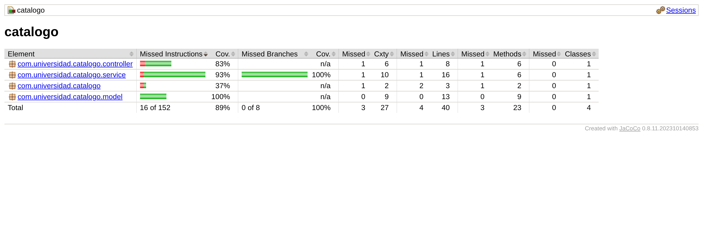
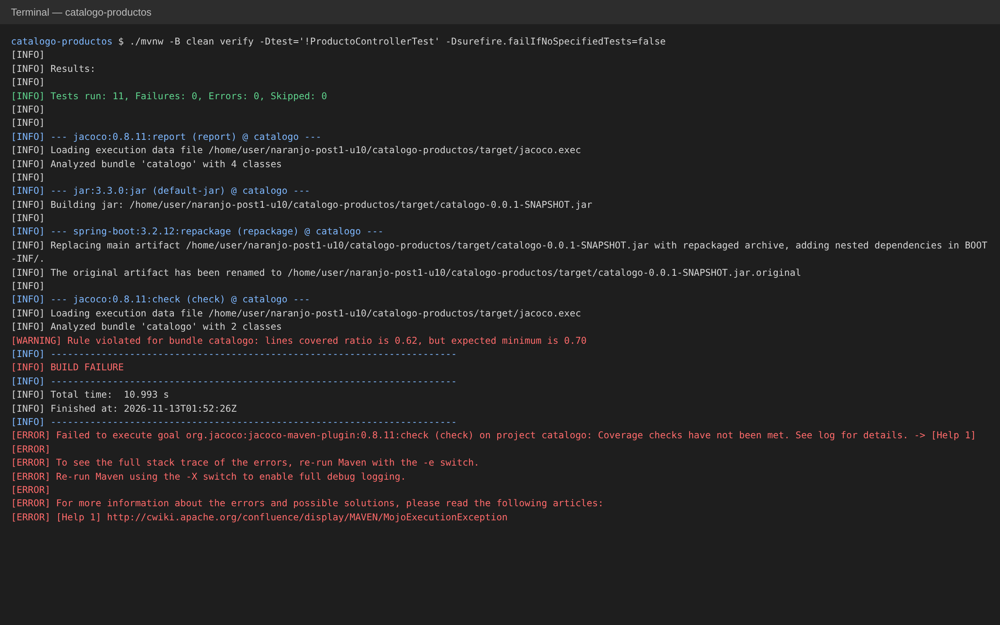
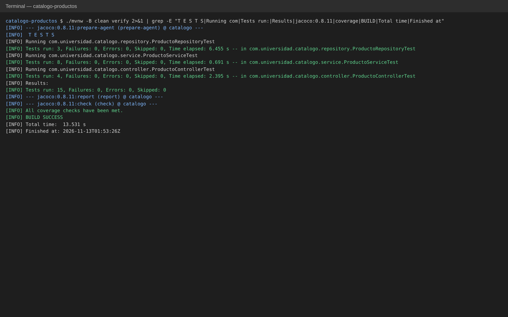
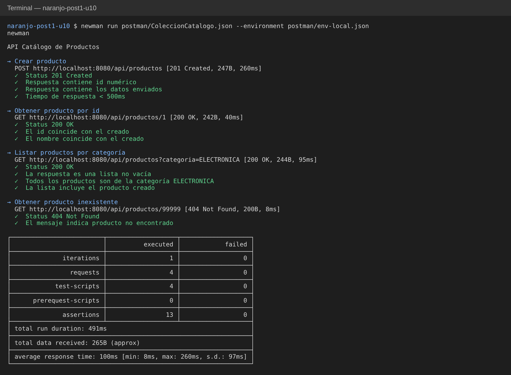

# Post-contenido — Unidad 10: Pruebas de Software en Aplicaciones Web

## Descripción

Repositorio del laboratorio de la Unidad 10 de Programación Web. Contiene un único proyecto Maven Spring Boot (`catalogo-productos/`) con una suite de pruebas unitarias, de integración y de capa web sobre un catálogo de productos, además de una colección Postman versionada y un umbral de cobertura verificado con JaCoCo.

El objetivo del laboratorio no es construir una aplicación nueva, sino escribir una suite de pruebas automatizadas completa sobre una aplicación pequeña a propósito. La aplicación ofrece cuatro operaciones de negocio:

- crear un producto;
- consultarlo por id;
- consultar los productos de una categoría;
- actualizar el precio de un producto.

El laboratorio tiene dos partes que conviven en el mismo proyecto y se evalúan juntas:

- **Parte 1:** pruebas unitarias con JUnit 5 y Mockito sobre `ProductoService`, y pruebas de integración con `@DataJpaTest` y H2 en memoria sobre `ProductoRepository`.
- **Parte 2:** pruebas de la capa web con `@WebMvcTest` y MockMvc sobre `ProductoController`, una colección Postman/Newman para pruebas de extremo a extremo y la configuración de JaCoCo con un umbral mínimo del 70 % de cobertura de líneas.

## Tecnologías y versiones

| Tecnología | Versión / detalle |
|---|---|
| Java | 17 (`java.version` en el `pom.xml`) |
| Spring Boot | 3.2.12 (`spring-boot-starter-parent`) |
| Maven | 3.9.11, mediante Maven Wrapper (`./mvnw`) |
| Spring Web | `spring-boot-starter-web` |
| Spring Data JPA | `spring-boot-starter-data-jpa` |
| Bean Validation | `spring-boot-starter-validation`, necesaria para `@NotBlank` en la entidad |
| Base de datos | H2 en memoria, para ejecución local y para pruebas |
| Pruebas | `spring-boot-starter-test` (JUnit 5, Mockito, AssertJ, MockMvc) |
| Cobertura | `jacoco-maven-plugin` 0.8.11 |
| Pruebas E2E | Postman (colección v2.1) y Newman 6.x (Node.js 18+) |

## Estructura del proyecto

```
naranjo-post1-u10/
├── README.md
├── capturas/
│   ├── jacoco-reporte.png
│   ├── jacoco-build-fallido.png
│   ├── tests-verde.png
│   └── postman-runner.png
├── postman/
│   ├── ColeccionCatalogo.json
│   └── env-local.json
└── catalogo-productos/
    ├── pom.xml
    ├── mvnw, mvnw.cmd, .mvn/wrapper/maven-wrapper.properties
    └── src/
        ├── main/
        │   ├── java/com/universidad/catalogo/
        │   │   ├── CatalogoApplication.java
        │   │   ├── model/Producto.java
        │   │   ├── repository/ProductoRepository.java
        │   │   ├── service/ProductoService.java
        │   │   └── controller/ProductoController.java
        │   └── resources/application.properties
        └── test/java/com/universidad/catalogo/
            ├── service/ProductoServiceTest.java
            ├── repository/ProductoRepositoryTest.java
            └── controller/ProductoControllerTest.java
```

Las clases de prueba replican la organización por paquetes del código de producción: `service`, `repository` y `controller`.

### Aplicación bajo prueba

- **`Producto`**: entidad JPA con `id` autogenerado (`GenerationType.IDENTITY`), `nombre` obligatorio (`@NotBlank`), `precio` (`double`) y `categoria` (`String`). La categoría es un texto simple, sin relación con otra entidad.
- **`ProductoRepository`**: extiende `JpaRepository<Producto, Long>` y declara la consulta derivada `findByCategoria(String categoria)`.
- **`ProductoService`**: contiene las reglas de negocio:
  - `crear` rechaza nombres nulos o vacíos y precios menores o iguales a cero;
  - `buscarPorId` lanza `EntityNotFoundException` si el producto no existe;
  - `listarPorCategoria` delega en el repositorio;
  - `actualizarPrecio` valida el nuevo precio, busca el producto y lo guarda.
- **`ProductoController`**: expone `POST /api/productos` (201), `GET /api/productos/{id}` (200) y `GET /api/productos?categoria=...` (200). Sus manejadores `@ExceptionHandler` traducen `EntityNotFoundException` a 404 e `IllegalArgumentException` a 400.

## Parte 1 — Pruebas unitarias con Mockito y de integración con @DataJpaTest

### `ProductoServiceTest`: prueba unitaria con Mockito

Prueba la lógica de negocio de `ProductoService` aislada de la base de datos y de Spring.

- **`@ExtendWith(MockitoExtension.class)`**: activa Mockito en JUnit 5 sin levantar ningún contexto de Spring, así que la prueba es muy rápida.
- **`@Mock ProductoRepository repo`**: sustituye el repositorio por un doble de prueba. Así se controla lo que devuelve (`when(...).thenReturn(...)`) y se verifica cómo se usa (`verify`).
- **`@InjectMocks ProductoService service`**: crea el servicio real e inyecta el mock por su constructor.
- **AssertJ (`assertThat`)**: comprueba los valores devueltos. **`assertThrows`** comprueba las excepciones y sus mensajes.
- **`verify(repo, never()).save(any())`**: demuestra que el repositorio no se invoca cuando una validación rechaza el dato.

| Test | Escenario |
|---|---|
| `crear_conDatosValidos_guardaYRetorna` | Caso feliz: guarda y devuelve el producto |
| `crear_conNombreVacio_lanzaIllegalArgumentException` | Nombre en blanco; no se guarda |
| `crear_conNombreNulo_lanzaIllegalArgumentException` | Nombre nulo; no se guarda |
| `crear_conPrecioNegativo_lanzaIllegalArgumentException` | Precio negativo; no se guarda |
| `crear_conPrecioCero_lanzaIllegalArgumentException` | Precio cero (límite de la regla «≤ 0»); no se guarda |
| `buscarPorId_noExiste_lanzaEntityNotFoundException` | Producto inexistente: excepción con su mensaje |
| `actualizarPrecio_conValorValido_actualizaYGuarda` | Actualiza el precio y guarda |
| `actualizarPrecio_conPrecioInvalido_lanzaIllegalArgumentException` | Precio inválido; no busca ni guarda |

### `ProductoRepositoryTest`: prueba de integración con @DataJpaTest

Prueba la consulta `findByCategoria` contra una base de datos real: H2 en memoria.

- **`@DataJpaTest`**: carga solo la capa de persistencia (entidades, repositorios, `EntityManager` y una base H2 embebida). Cada test se ejecuta en una transacción que se revierte al terminar.
- **`@Autowired ProductoRepository`**: el repositorio real generado por Spring Data, que es lo que se quiere probar.
- **`@Autowired TestEntityManager`**: inserta los datos de prueba (`persistAndFlush`) sin pasar por el repositorio, para no usar el código bajo prueba en la preparación de su propia prueba.
- **`@BeforeEach`**: con el método auxiliar `crear(nombre, precio, categoria)`, inserta "Laptop" (ELECTRONICA) y "Cuaderno" (PAPELERIA) antes de cada test.

| Test | Escenario |
|---|---|
| `findByCategoria_electronica_retornaUnProducto` | Devuelve exactamente "Laptop" |
| `findByCategoria_sinCoincidencias_retornaListaVacia` | "JUGUETERIA" devuelve una lista vacía |
| `findAll_trasSetUp_contieneSoloLosDosProductosDelTest` | Comprueba que los datos no se acumulan entre tests (rollback) |

## Parte 2 — Pruebas web con @WebMvcTest, Postman/Newman y JaCoCo

### `ProductoControllerTest`: prueba de la capa web con @WebMvcTest

Prueba el contrato HTTP del controlador (rutas, códigos de estado y JSON) sin servidor real y sin base de datos.

- **`@WebMvcTest(ProductoController.class)`**: carga solo la capa web (el controlador, sus convertidores JSON y sus `@ExceptionHandler`).
- **`@Autowired MockMvc`**: simula las peticiones HTTP dentro de la JVM, sin abrir un puerto real.
- **`@Autowired ObjectMapper`**: serializa a JSON el cuerpo de las peticiones POST.
- **`@MockBean ProductoService`**: registra un mock del servicio en el contexto de Spring. Es la anotación vigente en Spring Boot 3.2.x. Gracias a ella el test solo verifica la traducción entre HTTP y el servicio, no la lógica de negocio, que ya está probada en la Parte 1.

| Test | Escenario |
|---|---|
| `get_productoExiste_retorna200` | 200 y JSON con `id`, `nombre` y `precio` |
| `get_noExiste_retorna404` | El servicio lanza `EntityNotFoundException`: 404 y mensaje |
| `post_conDatosValidos_retorna201` | 201 y JSON con el `id` asignado |
| `post_conPrecioInvalido_retorna400` | El servicio lanza `IllegalArgumentException`: 400 y mensaje |

### Colección Postman/Newman: prueba de extremo a extremo

La colección **"API Catálogo de Productos"** (`postman/ColeccionCatalogo.json`) se ejecuta contra la aplicación real en marcha, con su base H2 real y sin mocks. Usa el entorno **"Catalogo-Local"** (`postman/env-local.json`), con `baseUrl = http://localhost:8080`. Sus cuatro requests se ejecutan en este orden:

| # | Request | Validaciones |
|---|---|---|
| 1 | Crear producto: `POST /api/productos` ("Teclado mecánico", 120.0, ELECTRONICA) | Status 201; `id` numérico, que se guarda en la variable de colección `productoId`; datos devueltos iguales a los enviados; tiempo de respuesta < 500 ms |
| 2 | Obtener producto por id: `GET /api/productos/{{productoId}}` | Status 200; `id` y `nombre` del producto creado |
| 3 | Listar productos por categoría: `GET /api/productos?categoria=ELECTRONICA` | Status 200; lista no vacía; todos los productos son de ELECTRONICA; incluye el producto creado |
| 4 | Obtener producto inexistente: `GET /api/productos/99999` | Status 404; mensaje "Producto no encontrado: 99999" |

### Cobertura con JaCoCo

El `pom.xml` incluye `jacoco-maven-plugin` 0.8.11 con tres ejecuciones:

- **`prepare-agent`**: instrumenta la JVM de las pruebas.
- **`report`**: se ejecuta en la fase `test` y genera el reporte HTML.
- **`check`**: se ejecuta en la fase `verify` y aplica la regla `BUNDLE` / `LINE` / `COVEREDRATIO` con un mínimo de `0.70`. Excluye del cálculo `**/*Application.class` y `**/model/**`.

Si la cobertura de líneas cae por debajo del 70 %, `./mvnw clean verify` falla.

**Resultados obtenidos en las ejecuciones del laboratorio:**

- **Suite completa:** 15 pruebas en verde, `All coverage checks have been met` y BUILD SUCCESS.
  - El reporte `index.html` muestra **36 de 40 líneas cubiertas (90 %)**.
  - Sin las clases excluidas, la cobertura que evalúa el `check` es **22 de 24 líneas (91,7 %)**: 15 de 16 en `ProductoService` y 7 de 8 en `ProductoController`.
- **Fallo deliberado del gate:** la suite se ejecutó sin `ProductoControllerTest`, excluyéndolo solo desde la línea de comandos y sin modificar ningún archivo:
  ```bash
  ./mvnw clean verify -Dtest='!ProductoControllerTest' -Dsurefire.failIfNoSpecifiedTests=false
  ```
  JaCoCo informó `lines covered ratio is 0.62, but expected minimum is 0.70` y el build terminó en **BUILD FAILURE**.

### Orden en que se agregaron los tipos de prueba

1. **Pruebas unitarias del servicio** (Mockito): la base de la pirámide; rápidas y aisladas.
2. **Pruebas de integración del repositorio** (`@DataJpaTest`): verifican la persistencia real con H2.
3. **Pruebas de la capa web** (`@WebMvcTest`): verifican el contrato HTTP con el servicio simulado.
4. **Pruebas de extremo a extremo** (Postman/Newman): verifican la aplicación completa en ejecución, como caja negra.
5. **JaCoCo al final**: mide la cobertura agregada una vez cubiertas las tres capas (ver la decisión 6).

## Decisiones de diseño

1. **H2 se usa también para la ejecución local, no solo para las pruebas.** El objetivo de la unidad es la escritura de pruebas, no el modelado de persistencia contra un motor externo como en la Unidad 8. Instalar y configurar MySQL solo añadiría fricción de infraestructura sin aportar a los objetivos de aprendizaje.
2. **`buscarPorId` lanza `EntityNotFoundException` en vez de retornar `null`.** El contrato del método queda explícito y se verifica con `assertThrows` en una sola línea. Además, ningún llamador tiene que acordarse de comprobar `null`, y el diseño es coherente con el manejo de errores de laboratorios anteriores.
3. **`ProductoRepositoryTest` usa `@DataJpaTest` en vez de `@SpringBootTest`.** Carga solo la capa de persistencia, con lo que la prueba queda aislada de fallos ajenos a ella y la suite es rápida. En un dominio tan pequeño la diferencia de tiempo es mínima, pero la práctica escala a proyectos con decenas de beans y es coherente con la base ancha y rápida de la pirámide de pruebas.
4. **`ProductoControllerTest` usa `@WebMvcTest` en vez de `@SpringBootTest` con `TestRestTemplate`.** `@WebMvcTest` arranca solo la capa web y simula las peticiones sin ocupar un puerto. `@SpringBootTest` levantaría el contexto completo, incluida la persistencia real, y volvería a probar lo que ya cubren `ProductoServiceTest` y `ProductoRepositoryTest`. Aislar la capa web evita duplicar cobertura entre niveles de la pirámide.
5. **La colección Postman se versiona como archivo `.json`, no como una prueba JUnit.** Postman prueba la aplicación como caja negra, mediante HTTP real contra un proceso en ejecución. Es un nivel de prueba distinto y complementario al de MockMvc, que nunca abre un socket. Valida el contrato HTTP completo (serialización JSON, códigos de estado y cabeceras) de forma reproducible fuera de la JVM y del ciclo de vida de Maven. Es, además, la herramienta que usaría un equipo de QA o un consumidor externo de la API.
6. **JaCoCo se configura al cierre de la Parte 2, no en la Parte 1.** Fijar el umbral antes de tener la suite completa mediría solo una parte del código y daría una falsa sensación de cumplimiento del 70 %. Medir la cobertura agregada al final, con las tres capas ya cubiertas, refleja el estado real del proyecto y evita que el umbral se apruebe artificialmente con una suite incompleta.
7. **Este laboratorio no incluye Selenium WebDriver.** El catálogo es una API REST pura: `ProductoController` devuelve JSON, no vistas Thymeleaf. Fabricar una vista HTML solo para tener algo que automatizar con Selenium añadiría una capa de presentación ficticia, ajena al alcance de la unidad, y contradiría la pirámide de pruebas, que reserva las pruebas E2E de interfaz para flujos de usuario reales. En un proyecto con vistas (como el catálogo con formularios de la Unidad 8), Selenium con el patrón Page Object Model sí sería la herramienta adecuada. Aquí, la colección Postman cumple el papel de prueba de extremo a extremo sobre la superficie que realmente expone la aplicación: la API HTTP.

## Cómo compilar y ejecutar

**Requisitos:**
- JDK 17 o superior. No hace falta instalar Maven, porque el proyecto incluye Maven Wrapper.
- Node.js 18+ con npm, solo para ejecutar Newman.

1. Clona el repositorio:
   ```bash
   git clone https://github.com/JimmyN44/naranjo-post1-u10.git
   ```
2. Arranca la aplicación desde `catalogo-productos/`. Queda en `http://localhost:8080`, con la consola H2 en `/h2-console` (JDBC URL `jdbc:h2:mem:catalogo`, usuario `sa`, sin contraseña).
   ```bash
   cd naranjo-post1-u10/catalogo-productos
   ```
   ```bash
   ./mvnw spring-boot:run
   ```
   En Windows se usa `mvnw.cmd` en lugar de `./mvnw`.

### Pruebas con Maven

Todos los comandos se ejecutan dentro de `catalogo-productos/`.

- Suite completa (unitarias, de integración y web):
  ```bash
  ./mvnw clean test
  ```
- Una sola clase de prueba:
  ```bash
  ./mvnw test -Dtest=ProductoServiceTest
  ```
- Suite completa con verificación de cobertura. Genera el reporte JaCoCo y falla si la cobertura de líneas es menor del 70 %:
  ```bash
  ./mvnw clean verify
  ```

### Colección Postman con Newman

1. Instala Newman (una sola vez):
   ```bash
   npm install -g newman
   ```
2. Con la aplicación en ejecución (paso 2 de la sección anterior), ejecuta desde la raíz del repositorio:
   ```bash
   newman run postman/ColeccionCatalogo.json --environment postman/env-local.json
   ```

Como H2 está en memoria, conviene reiniciar la aplicación antes de cada ejecución para partir de una base vacía.

Para usar Postman, importa `postman/ColeccionCatalogo.json` y `postman/env-local.json`, selecciona el entorno **Catalogo-Local** y ejecuta la colección desde el **Collection Runner**.

### Reporte de cobertura JaCoCo

Después de `./mvnw clean verify` (o `./mvnw test`), el reporte queda en:

```
catalogo-productos/target/site/jacoco/index.html
```

Se abre en el navegador y muestra la cobertura por paquete, clase y método. Las líneas verdes están cubiertas, las rojas no y las amarillas tienen ramas cubiertas solo en parte.

## Capturas de pantalla








